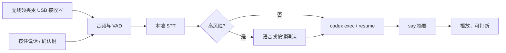

# codex-voice-orb

按住说话，把一句话交给你 Mac 上的 Codex CLI，再把回复里的短结论读出来。形态上接近 OPPO 的「心力球」：领夹麦负责收音，智能体在另一头做事。这里的智能体是本机的 `codex`，硬件是现成的无线领夹麦和 Mac 的扬声器或耳机。

这不是实时闲聊音箱。Codex 要思考、读仓库、跑命令，一轮经常要几秒到几十秒。说完会先听到一声「好。」，完整回复打在终端里，语音只读一句摘要。

## 一轮对话

1. 按住热键说话（默认 `Ctrl+Space`），或让 VAD 在你停顿后收尾。
2. 本机 faster-whisper（或 whisper.cpp）转成中文或英文。
3. 若这句话像删除、部署、付款、发消息、合并、推送这类高风险操作，先等你说「确认」或按确认键。十秒内不确认就取消。
4. 通过 `orb/backends/codex_cli.py` 调用 `codex exec`。下一轮用保存的 thread id 走 `codex exec resume <id>`。
5. macOS `say` 合成摘要，`afplay` 播放。你再次开口或按下热键时，播放立刻停。

默认沙箱是 `read-only`。需要改仓库里的文件时，把配置改成 `workspace-write`。这两种是 v0.1 的默认沙箱。程序不会自己加上 `--full-auto`、`--yolo` 或 `danger-full-access`。



## 硬件

买一个带 USB 接收器的无线领夹麦，插上后 macOS 把它当成输入设备。播放用 Mac 自带扬声器，或有线耳机。价格是估计：

| 东西 | 说明 | 估价 |
| --- | --- | --- |
| 无线领夹麦 | USB 接收器，Mac 显示为输入设备。RØDE Wireless GO、大疆 Mic Mini，或国产 USB 款都可以。[京东搜索](https://search.jd.com/Search?keyword=%E6%97%A0%E7%BA%BF%E9%A2%86%E5%A4%B9%E9%BA%A6) | ¥150–1500 |
| 播放 | Mac 扬声器或已连接的耳机 | ¥0–300 |
| 可选会议麦 | 自带回声消除，外放时更不容易把自己的声音又录进去 | ¥300–800 |

麦走 USB，不要同时用蓝牙麦和蓝牙音箱，否则系统会掉到免提通话的音质。外放时，喇叭声可能被 VAD 当成你在插话。第一版用按住说话，或者戴耳机。

## 在 Mac 上安装

需要 Homebrew、Python 3.11 或更新版本，以及已经能在终端里运行的 Codex CLI。本方案按 `codex-cli 0.153.4`、路径 `/opt/homebrew/bin/codex` 来写。先确认：

```bash
/opt/homebrew/bin/codex --version
/opt/homebrew/bin/codex login status
```

`login status` 退出码为 0 才算登录过。没有的话执行 `codex login`。

```bash
brew install python@3.12
git clone https://github.com/AlexJCD2025/codex-voice-orb.git
cd codex-voice-orb
python3.12 -m venv .venv
source .venv/bin/activate
pip install -e ".[audio,stt,hotkey]"
cp config.example.yaml config.yaml
```

`config.yaml` 里的 `codex.bin` 保持 `/opt/homebrew/bin/codex`。若 `which codex` 在别的位置，改成那个路径。

第一次转写会下载 faster-whisper 的 `small` 模型，能同时处理中文和英文。想更准，把 `stt.model` 改成 `medium` 或 `large-v3`。也可以改用 whisper.cpp：安装 `whisper-cli`，把 ggml 模型路径写到 `stt.model_path`，再把 `stt.engine` 设为 `whisper.cpp`。

### 系统权限

- 系统设置 → 隐私与安全性 → 麦克风：打开「终端」（或 iTerm，看你从哪个 App 启动）。
- 全局热键还要在同一页打开「输入监视」。pynput 读不到按键时，先看这一项。
- 插上 USB 接收器。`orb doctor` 会打印输入设备名。若不用系统默认麦克风，把名字写进 `audio.input_device`。

## 配置

`config.example.yaml` 里每项都有注释。常用的只有这些：

- `audio.mode`：`ptt` 或 `vad`
- `audio.hotkey` / `audio.confirm_key`：按住说话，以及高风险确认键
- `codex.sandbox`：`read-only` 或 `workspace-write`
- `codex.model`：传给 `codex exec -m`
- `codex.config_overrides`：每一项变成一次 `-c KEY=VALUE`
- `codex.images` 或命令行 `--image`：传给 `--image`
- `codex.resume`：`id` 用上次的 thread id；`last` 则调用 `codex exec resume --last`
- `tts.voice`：例如 `Ting-Ting`。不填就用系统默认声音

`permissions.allow_full_auto` 和 `allow_danger_full_access` 默认都是 `false`。打开之后，每一轮仍然要先语音或按键确认，程序才会把对应的危险参数传给 Codex。

## 第一次真机测试

在插了麦、登录过 Codex 的 Mac 上按这个顺序做。前两步不需要热键。

1. 看环境缺什么：

   ```bash
   source .venv/bin/activate
   orb doctor
   ```

   麦克风、`codex` 路径、`codex login status`、STT 模型、`say` 都应该是 `pass`。STT 模型还没下载时是 `warn`，第一次转写会自己下。有 `fail` 就先按上一节处理，不要往下走。

2. 只测 Codex 和朗读，不测麦：

   ```bash
   orb once --text "用两句话说明当前目录是做什么的"
   ```

   终端会打出完整回复，扬声器或耳机会读一句摘要。这一步失败时，先看 `codex login status`，以及 `config.yaml` 里的 `codex.bin`。

3. 测多轮是不是同一条 Codex 会话：

   ```bash
   orb listen --stdin
   ```

   输入 `记住数字四十二`，回车，等它读完。再输入 `我刚才让你记的数字是多少`。第二轮的命令行里会带 `resume` 和上一轮的 thread id。空行退出。看会话：

   ```bash
   orb session show
   orb session clear
   ```

4. 测麦。按住 `Ctrl+Space`，说「这个目录里有哪些文件」，松开。听到「好。」之后等待，然后听到一句摘要。终端里同时有全文。

   ```bash
   orb listen
   ```

5. 测打断。等它开始朗读时，再按住热键说话。正在播的声音应马上停，新的一句进入下一轮。

6. 测高风险确认。说「把临时文件删掉」，或：

   ```bash
   orb once --text "把临时文件删掉"
   ```

   它应先要求确认，并且在你说「确认」或按 `Ctrl+Shift+Y` 之前不调用 Codex。说「取消」，或干等十秒，这一轮就结束。确认之后，Codex 仍跑在 `read-only` 或你配置的 `workspace-write` 里，不会变成 full-auto。

7. 看延迟。每一轮追加一行 JSON，里面是各段毫秒数，没有原文：

   ```bash
   tail -f ~/.codex-voice-orb/metrics.jsonl
   ```

   字段包括 `stt_ms`、`permission_ms`、`codex_ms`、`tts_ms`、`playback_ms`、`total_ms`。

要改仓库里的文件时，把 `codex.sandbox` 改成 `workspace-write`，再从第 2 步做一次。删除、推送、发消息这类话仍然要先确认。

## 命令

| 命令 | 作用 |
| --- | --- |
| `orb doctor` | 检查麦、Codex、登录、STT、TTS |
| `orb once --text "..."` | 跳过麦，直接问一轮。`--image` 可重复 |
| `orb once --text "..." --no-tts` | 只打印，不调用 `say` |
| `orb listen` | 热键或 VAD |
| `orb listen --stdin` | 用键盘打字，验证 resume |
| `orb session show` / `orb session clear` | 查看或忘掉 thread id |

配置文件可以用 `orb --config /path/to/config.yaml doctor` 指定。

## 安全边界

- 音频文件默认在转写后删除。指标日志只记耗时和字符数。
- 发给 Codex 的是文字。`voice_preamble` 会请它先给一句能直接朗读的结论。
- 高风险词是粗筛，覆盖中英常见的删除、部署、购买、付款、发消息、合并、推送。没命中的危险命令，如果出现在 Codex 的 `command_execution`、删除文件或发送类 MCP 工具事件里，且这一轮没有确认过，进程会被停掉。这是辅助，真正卡住写盘和网络的是 Codex 沙箱。
- 打断只能停掉本机播放和还在跑的 `codex exec` 子进程。已经在沙箱里执行完的命令不会自动撤销。
- 回复里的文字只会被朗读，不会被当成新的 shell 指令。

## 开发

后端接口在 `orb/backends/base.py`。再接一个智能体时，实现 `ask()` 并在 `build_runtime()` 里换上即可。TTS 同样只要求 `synthesize(text, turn_id) -> 音频路径`。

单元测试用假的 Codex 进程，不连网，在 Ubuntu 上就能跑：

```bash
pip install -e ".[dev]"
python -m pytest -q
python -m orb doctor
```

GitHub Actions 在 `ubuntu-latest` 上跑 pytest，并确认 `doctor` 能打印 microphone、codex、stt、tts 四项。这台 Linux 机器上麦、`say` 和 Codex 不存在，`doctor` 会报告失败项，但命令本身要能跑完。

## 布局

```
orb/audio.py            采集、按住说话、RMS VAD
orb/stt.py              faster-whisper / whisper.cpp
orb/tts.py              say，可替换
orb/playback.py         播放与打断
orb/orchestrator.py     一轮的状态、确认、打断
orb/permissions.py      高风险粗筛和确认词
orb/session.py          thread id
orb/backends/codex_cli.py
orb/config.py  orb/cli.py  orb/metrics.py  orb/doctor.py
```
